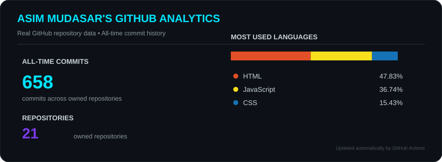
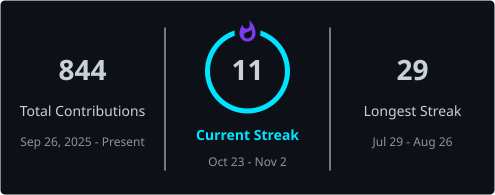

<div align="center">


</div>

<br/>


<div align="center">


<br/>


<br/><br/>

<a href="https://github.com/asimmudassar541-ship-it">

</a>

<a href="https://linkedin.com/in/asim-mudassar-72a62a384">

</a>

</div>

---


##  SYSTEM.INFO


```text


╭──────────────────────────────────────────────────────────────╮
│                                                              │
│   > INITIALIZING ASIM.DEV                                    │
│   > SYSTEM STATUS: ONLINE                                    │
│                                                              │
├──────────────────────────────────────────────────────────────┤
│                                                              │
│   IDENTITY                                                   │
│   ├── NAME       : Asim Mudasar                              │
│   ├── ROLE       : Software, DevOps & Cloud Engineer         │
│   ├── SPECIALTY  : MERN Stack | AWS Cloud | DevOps           │
│   └── LOCATION   : Pakistan                                  │
│                                                              │
│   FRONTEND                                                   │
│   ├── React.js / Next.js                                     │
│   ├── TypeScript / JavaScript                                │
│   ├── HTML5 / CSS3                                           │
│   └── Tailwind CSS / Bootstrap                               │
│                                                              │
│   BACKEND                                                    │
│   ├── Node.js / Express.js                                   │
│   ├── REST APIs / Microservices                              │
│   └── JWT Authentication / Security                          │
│                                                              │
│   DATABASE                                                   │
│   ├── MongoDB (NoSQL)                                        │
│   └── MySQL (Relational)                                     │
│                                                              │
│   DEVOPS & CLOUD                                             │
│   ├── AWS Cloud Architecture                                 │
│   ├── Docker Containerization                                │
│   ├── CI/CD Pipelines & GitHub Actions                       │
│   └── Kubernetes & Terraform (IaC)                           │
│                                                              │
│   DEVELOPMENT TOOLS                                          │
│   ├── Git / GitHub                                           │
│   ├── VS Code / Postman                                      │
│   └── Vercel / Firebase                                      │
│                                                              │
│   STATUS                                                     │
│   ├── BUILDING   : Full Stack & Cloud Systems                │
│   ├── AUTOMATING : CI/CD & Deployments                       │
│   └── SHIPPING   : Production Ready Apps                     │
│                                                              │
╰──────────────────────────────────────────────────────────────╯


```


---

##  ABOUT ME

Hi, I'm **Asim Mudasar**, a **Full Stack**, **DevOps**, and **Cloud Engineer** focused on building modern, responsive web applications and automated cloud infrastructure.

I enjoy turning ideas into scalable, production-ready products using the **MERN Stack**, **Docker**, and **AWS Cloud**, continuously improving my engineering skills through real-world projects.

-  Building full-stack web applications and robust system architectures
-  Working with React.js, Next.js, and modern frontend technologies
-  Developing secure backend APIs with Node.js & Express.js
-  Managing NoSQL and relational databases (MongoDB & MySQL)
-  Automating deployments using Docker, CI/CD pipelines, and GitHub Actions
-  Configuring cloud environments and infrastructure with AWS
-  Continuously learning modern software development and cloud technologies
-  Interested in scalable, highly available, and user-centric applications

---

##  TECH STACK

<div align="center">

###  FRONTEND


<br><br>

###  BACKEND


<br><br>

###  DATABASE


<br><br>

###  DEVOPS & CLOUD


<br><br>

###  TOOLS


<br><br>

###  DEVELOPMENT


</div>

---

##  FEATURED PROJECTS

<table>
<tr>
<td width="50%">

### 📱 Household Expense Tracker

A full-stack financial tracking application featuring secure JWT authentication and cross-platform architecture.

**Tech:**  
`React Native` `Node.js` `Express` `MySQL` `JWT`

</td>

<td width="50%">

### 🏦 Bank Management System

A secure full-stack banking management platform supporting account operations and transaction workflows.

**Tech:**  
`React` `Node.js` `Express` `MongoDB`

</td>
</tr>

<tr>
<td width="50%">

### 🛒 E-Commerce Website

A feature-rich online shopping platform focused on product management, cart handling, and secure routing.

**Tech:**  
`React` `Express` `MongoDB` `Node.js`

</td>

<td width="50%">

### 🍔 Food Ordering Website

A dynamic food delivery web application offering interactive menus and user order management.

**Tech:**  
`MERN Stack` `REST API` `MongoDB`

</td>
</tr>

<tr>
<td width="50%">

### 🧮 Responsive Calculator

A sleek and modern web utility built with clean UI logic and precise state computations.

**Tech:**  
`JavaScript` `HTML5` `CSS3`

</td>

<td width="50%">

### 🖼️ Image Gallery & 🎵 Music Player

Interactive web applications featuring responsive media grids, custom audio controls, and clean UI design.

**Tech:**  
`JavaScript` `CSS3` `DOM Manipulation`

</td>
</tr>
</table>

---


##  GITHUB ANALYTICS

<div align="center">



</div>

---

##  GITHUB TROPHIES

<div align="center">


</div>


---

##  CONTRIBUTION STREAK

<div align="center">



</div>

---

##  CONTRIBUTION GRAPH

<div align="center">


</div>

---

##  CURRENT FOCUS

<div align="center">

| 🚀 Area | 🎯 Current Focus |
|---|---|
| ⚛️ Full Stack MERN | Building robust web and mobile cross-platform applications |
| ☁️ DevOps & Cloud | Automating deployments with Docker, CI/CD pipelines, and AWS |
| 🟢 Backend & APIs | Architecting scalable RESTful services with Node.js & Express |
| 🍃 Database & Security | Designing efficient schemas with MongoDB/MySQL and JWT authentication |
| 🚀 Infrastructure | Practicing Infrastructure as Code (IaC) and cloud management |

</div>

---

## 🎯 2027 GOALS

<div align="center">

| 🎯 Goal | 📌 Progress |
|---|---|
| 🚀 Deploy production-ready full-stack & cross-platform apps | ✅ Completed / 🚀 Ongoing |
| ☁️ Master AWS cloud architecture & server deployments | 🔄 In Progress |
| 🐳 Implement Docker containerization & CI/CD automation pipelines | 🔄 In Progress |
| 🟢 Advanced backend system design & database optimization | 🔄 In Progress |
| ⚛️ Build high-performance interfaces with React & Next.js | ✅ Completed / 🚀 Ongoing |
| 🌍 Contribute to Open Source & Developer Community | 🎯 Planned |
| 💼 Establish strong professional profile as a Software, DevOps & Cloud Engineer | 🚀 Ongoing |

</div>

---

##  Professional Links

<div align="center">

<a href="https://github.com/asimmudassar541-ship-it"></a>&nbsp;&nbsp;&nbsp;&nbsp;
<a href="https://linkedin.com/in/asim-mudassar-72a62a384"></a>&nbsp;&nbsp;&nbsp;&nbsp;
<a href="https://asim-portfolio-green.vercel.app/"></a>
<br>

###  Open to learning, collaboration & new opportunities

</div>

---

<div align="center">


<br><br>

###  Thanks for visiting my profile!

`Building • Learning • Shipping`

<br>

 Feel free to Contact me.

</div>
